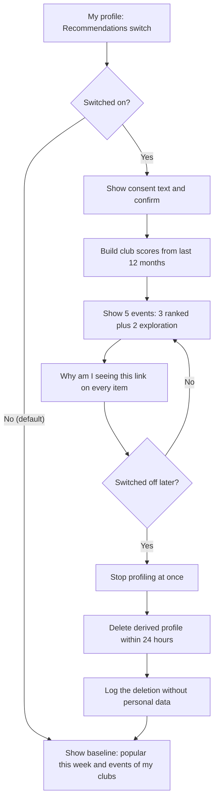

# AI feature proposal: "Recommended for you"

Version 0.1 · 2026-11-10 · Authors: CHENG Varyroitanak (Product Owner) and team KoPrei

## 1 Problem and non-personalised baseline

The clubs office wants a list of five upcoming events for each student, picked from their attendance history. We think the real problem is simpler: a student who joins one club often never hears about events from the others. Today that depends on which group or page they happen to follow (as far as our team has seen: Telegram groups, club Facebook pages and posters around campus). Small clubs have the opposite problem. Their events exist, but nobody sees them.

We don't think the first step is a model. We'd start with three lists that use no personal data:

- **Popular this week:** events sorted by how many students registered in the last 7 days. It's a count, with no names.
- **Events of my clubs:** upcoming events of the clubs the student already belongs to.
- **Starting soon:** events in the next 48 hours that still have free seats.

The baseline gives us a number to beat. If "popular this week" already gets students to register, a personalised list might not be worth the privacy cost. We don't know yet, and that is the point of running it first.

## 2 Data needed

| Field | Source | In inventory? | New purpose / consent? | Minimisation |
|-------|--------|---------------|------------------------|--------------|
| studentId | data/students.csv | yes | no | internal key only, masked in logs |
| clubMemberships | club records | yes | only if used for ranking (the baseline's "my clubs" list needs nothing new) | read only, never copied elsewhere |
| attendance (checked in only) | data/registrations.csv | yes, for reports | yes: personalisation is a new purpose, so opt-in consent | last 12 months, only event ID, club ID and month, no exact times |
| event features: club, date, start time, language (Khmer or English), capacity | data/events.csv | no personal data | no | the language field is new, so we need to add it to events |
| derived profile (score per club) | computed weekly | no, new | yes: it is new stored data | scores, not the raw history; deleted on opt-out |

We don't use name, email, phone, or any free-text field.

**What would change in our Task 1 inventory** (we have to check this against the final file):

1. `attendance` gets a second purpose. Reporting stays as it is, and personalisation needs consent.
2. We add a row `recommendationProfile`. Keep optional, visible only to the student, never to organisers or club leaders. It is deleted when the student switches off, or 12 months after their last attendance.
3. The copies section gets a rule: the derived profile is left out of CSV exports and shared backups, and test fixtures use invented students only.

Cambodia's data-protection rules are still developing, so we use GDPR principles as our design reference, the same as the rest of the course. The purpose-limitation principle is the one that matters most here. We collected attendance to run events, not to profile people.

## 3 Bias risks

We found more than four. These are the ones we think matter most at ITC.

| Risk | Who is harmed | Mitigation | Fairness check (metric, threshold) |
|------|---------------|------------|------------------------------------|
| New students have no history | first-year and newly joined students | show the baseline list until there is enough history | every new student sees five items; their click-through is at least 80 % of established students (starting threshold) |
| Popularity feedback loop: popular events get recommended, so they get more popular | students who would enjoy quieter events; small clubs | at least 2 of the 5 slots are exploration slots from clubs the student has never attended | automated monthly check: every list has at least 2 exploration slots |
| Large clubs crowd out small ones | small clubs and their members | normalise scores per club; reserve one slot for a small club | clubs with fewer than 20 members get at least 80 % of their fair share (share of recommendations divided by share of events) |
| Attendance is a proxy for money, distance or disability | students who can't pay, travel or enter a venue | never use price or location as a signal; never treat "didn't attend" as "not interested" | free events are recommended at no less than 90 % of their share of upcoming events |
| Khmer and English events: if past attendance leans one way, the list keeps pushing that language | students who prefer or need the other language | language is not a ranking input; exploration slots include both languages | share of Khmer and English events in lists is within 10 points of their share of upcoming events |
| Exam weeks and holidays (for example Khmer New Year, Pchum Ben) make attendance dip | everyone, but especially active students | ignore exam weeks and public holidays when computing profiles | scores for a month with an exam week don't drop more than 15 % below the average |

We are least sure about the thresholds. 80 % and 90 % are our own starting values, copied from the lab example and then adjusted. We'd review them after the first month of real numbers.

Commuting students are a risk we can't fully fix. A student who travels in from outside Phnom Penh may skip evening events for reasons that have nothing to do with interest. Because we never use location as a signal, the system can't see that, but it also can't help. We don't have a good answer yet. One option is to show event start time clearly, so the student decides.

### Assumptions we used

We don't have the clubs office's real figures yet, so we made these up to test our thresholds. They are placeholders and the client should replace them.

| Assumption | Value we used |
|------------|---------------|
| Active clubs | about 24 |
| Upcoming events in a typical month | about 40 |
| Clubs with fewer than 20 members | about 9 of the 24 |
| Share of events in Khmer / in English | roughly 60 % / 40 % |
| Students who join at least one club | about 1 in 3 |

With these numbers, 9 small clubs would hold about a third of the clubs but run fewer events each, which is why we picked 20 members as the "small club" line. If the real numbers are very different, we'd move the line.

## 4 Transparency

**"Why am I seeing this?" for one event:**

> Suggested because you attended 3 events of the Robotics Club in the last 12 months. We did not use your name, contact details, or anything other students told us. [Turn off recommendations] [See what we use]

**For an exploration slot** (invented event: "Khmer Calligraphy Workshop"):

> Suggested to help you discover new clubs. This is a popular event from a club you haven't attended.

**Ranking inputs the clubs office could publish:**

1. How many events you attended per club in the last 12 months (counted, not listed).
2. Which clubs you belong to.
3. How many students registered for the event recently.
4. Whether the event still has free seats and hasn't started.
5. Two of the five slots are always reserved for clubs you haven't attended.

Not used: name, email, phone, price, location, or anything a student typed freely. We would also keep clubs that could reveal something sensitive (for example a religious club) out of the profile, and never name them in an explanation. The clubs office would decide which clubs count as sensitive, because we shouldn't decide that alone.

## 5 Opt-out design

We chose **opt-in, off by default**. Attendance was collected so events could run, not so we could profile students. Using it for suggestions is a new purpose, so it needs a yes. A student who does nothing still gets the baseline list, so nobody loses the feature.

**Where the switch is:** My profile, Privacy, "Recommended for you" in the web and mobile apps. In the CLI it would be `clubhub privacy recommendations on|off`.

**When a student switches it off:** profiling stops immediately, the derived profile is deleted within 24 hours, and the list goes back to the baseline. Their attendance records stay, because events need them, under the retention rule we already have.

## 6 Recommendation

**Decision: GO WITH CONDITIONS.** We would not release it before the baseline has been live for a month, and not before the report restriction (issue #9) is done. We can't do the month of measuring inside this semester, so for this course it stays a proposal.

**Conditions:**

1. Opt-in, off by default. Switching off deletes the student's derived profile within 24 hours.
2. Only attendance from the last 12 months and club memberships are used: no name, email, phone or free text.
3. At least 2 of the 5 slots show events from clubs the student has never attended.
4. Monthly exposure check: clubs with fewer than 20 members get at least 80 % of their fair share, and free events at least 90 %.
5. The privacy notice and the data inventory are updated, and students see the consent text before release.
6. Every suggestion has a "Why am I seeing this?" link, and sensitive clubs are never named.
7. The clubs office can switch the whole feature off at any time.

**Owner of the fairness check:** the clubs office, as the data controller. Our team would write the monthly report script and fix any failed check within one sprint.

**Open questions for the client:** What are the real numbers of clubs, events and club sizes, so we can replace our assumptions? Who decides which clubs count as "sensitive"? Can the clubs office check the monthly fairness report?