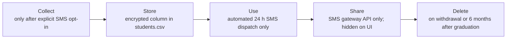

# Data inventory · ITC Club Hub
Version 0.1 · 2026-11-06 · Author: Pho Phatsophal

| Field | Subject | Purpose | Legal basis / consent | Retention | Who can see it | Stored in | Decision |
|-------|---------|---------|-----------------------|-----------|----------------|-----------|----------|
| studentId | student | identify; block double registration | necessary for the service | until 6 months after graduation | student (own), administrator; organiser sees masked | data/students.csv | Mask for organisers (e2022****): they only need to tell students apart, not read the full ID |
| name | student | shown on event rosters and check-in lists | necessary for the service | until 6 months after graduation | student, organiser, club leader, administrator | data/students.csv | Keep: organisers can't run check-in without it |
| email | student | event confirmations and cancellation notices | necessary for the service | until 6 months after graduation | student (own), administrator | data/students.csv | Mask on screen (t***@itc.edu.kh): only the mailer needs the full address |
| phone | student | SMS reminder 24 h before an event, only if chosen | consent (opt-in) | deleted on withdrawal, otherwise 6 months after graduation | nobody on screen; read only by the reminder sender | data/students.csv (encrypted column) | Keep optional: SMS reaches students without mobile data |
| clubMemberships | student | decide which club events and reports a student can access | necessary for the service | until membership ends | student (own), that club's leader, administrator | data/memberships.csv | Keep: needed for the club access rules |
| attendance | student | turnout report per event and club | legitimate interest: clubs need turnout numbers to plan rooms and events | 1 academic year, then aggregated counts only | organiser and leader of that event | data/registrations.csv | Aggregate: after the event, leaders see counts, not named lists |
| dateOfBirth | student | none: no feature, rule or report uses it | none | not collected | nobody | not stored | Drop: "might be useful" is not a purpose |
| photo | student | none: no screen needs a profile picture | none | not collected | nobody | not stored | Drop: identifying data with no feature behind it |
| faculty / year | student | club targeting and turnout stats | consent (optional field) | until 6 months after graduation | administrator; organiser sees aggregate only | data/students.csv | Aggregate: show "30% year 2", never per person |

## Copies of personal data
| Copy | Rule |
|------|------|
| log files | only `redacted()` output, never name, email or phone |
| CSV exports | only administrator and the leader of that club can export; studentId masked, no phone column; delete the file after use |
| test fixtures | fake data only (generated names, dummy IDs like e0000****), never real student records |
| backups | encrypted, administrator access only, deleted after 30 days; withdrawn data is gone by the next backup cycle |
| screenshots in docs | use fake data, or blur names, IDs, emails and phones before committing |

## Lifecycle of the phone field

## Client feedback
- TODO: fill in after the 5-minute walkthrough of the Drop decisions (dateOfBirth, photo) with the TA.
- Product Owner: ITC Club Hub Product Owner.
- Client: Teaching Assistant (acting client).
- Review: Walk through all Drop decisions, explaining why each field has no necessary purpose in the current system.
- Client objections: Record any objections raised by the teaching assistant here.
- Client response: Pending discussion with the teaching assistant.
- Final decision: Update the inventory if the teaching assistant identifies a genuine requirement. Do not collect additional personal data without an approved purpose and retention rule.