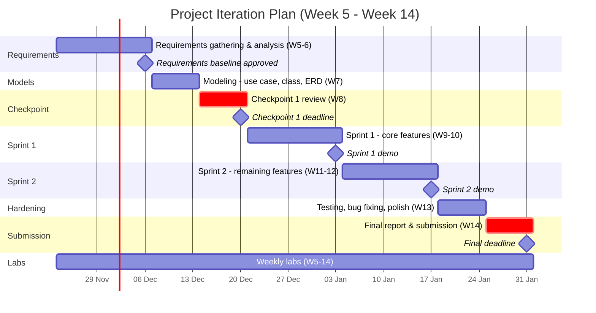

# Task 4: Iteration Plan for Week 5-14

## Step 1: Mermaid Gantt Chart



## Step 2: Iteration Goal Table

| Iteration | Weeks | Goal | Features | Capacity | Exit Criterion |
|---|---|---|---|---|---|
| Requirements | 5 - 6 | Understand and document what the system must do | Stakeholder analysis, user stories, functional and non-functional requirements | 48 h | Requirements document reviewed and approved by the team/supervisor |
| Modeling | 7 | Turn requirements into design models | Use case diagram, class diagram, ERD, sequence diagrams | 24 h | All models consistent with requirements and reviewed |
| Checkpoint 1 | 8 | Show progress and get feedback | Requirements + models presentation, initial prototype or mockups | 24 h | Checkpoint 1 passed; feedback items logged |
| Sprint 1 | 9 - 10 | Deliver the core working system | Highest-priority features (e.g. login, main CRUD, core workflow) | 48 h | Core features working, tested and demoed |
| Sprint 2 | 11 - 12 | Deliver remaining features | Secondary features, reports, integration, feedback fixes | 48 h | All planned features implemented and demoed |
| Hardening | 13 | Make the system stable | Testing, bug fixes, UI polish, documentation | 24 h | No critical bugs; test cases pass |
| Submission | 14 | Finalize and hand in | Final report, slides, source code, demo | 24 h | Everything submitted before the deadline |


## Step 3: Calculate Sprint Capacity

```
Capacity = Members x Hours per week x 2 weeks x 0.8
```

Our team:

```
Members = 5 (Cheng Varyroitanak, Suonghan Sethaleap, Yen Chavorn, Pho Phatsophal, Tang Hengly)
Hours per week = 6
Capacity = 5 x 6 x 2 x 0.8 = 48 hours
```